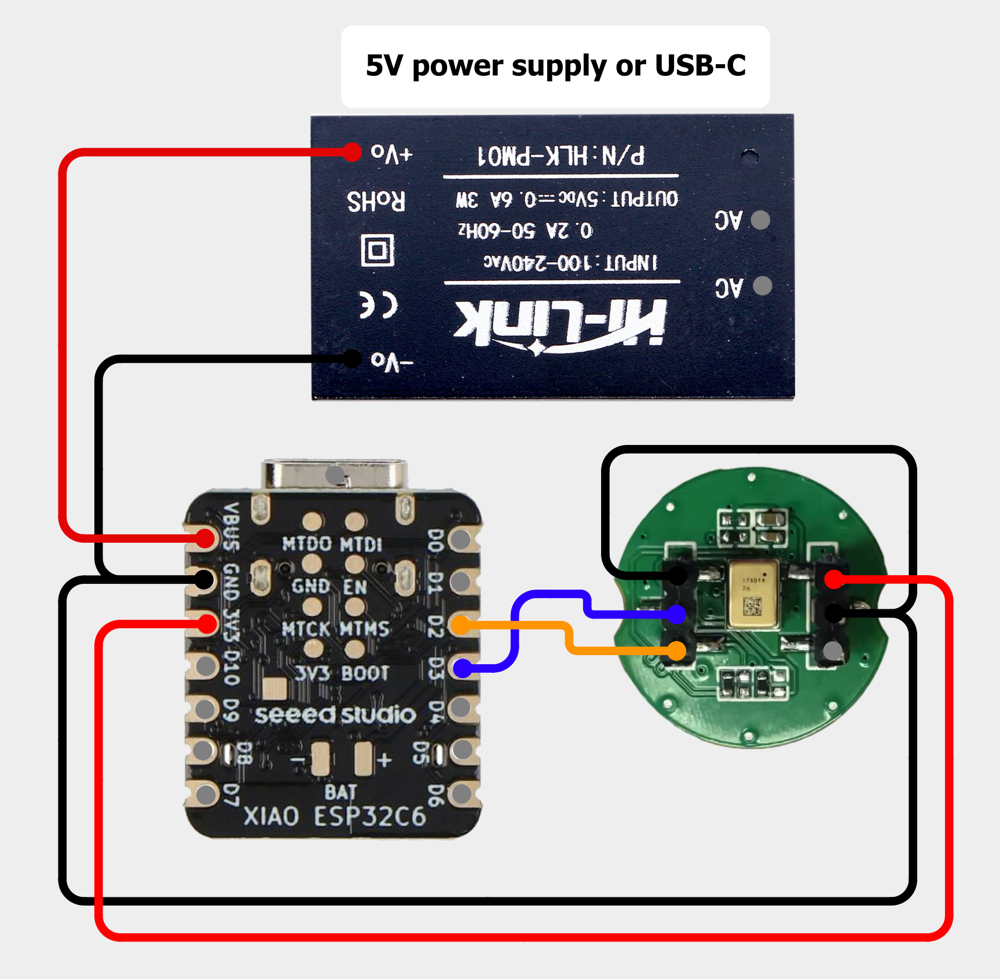

<p align="center">
  
</p>

# BirdNETMic — ESP32 Wi-Fi RTSP Microphone for BirdNET-Go and BirdNET-Pi

**BirdNETMic** is open-source ESP32 microphone firmware for **bird sound recording and
bird identification with BirdNET-Go and BirdNET-Pi**. Stream mono PCM audio over Wi-Fi
using RTSP, listen in your browser, and configure the microphone through a local Web UI.
VLC and ffmpeg can receive the audio too.

Use a **Seeed Studio XIAO ESP32-C3, S3, C5 or C6** with an I2S or PDM microphone,
or choose the **M5Stack AtomS3U** with its built-in microphone for the easiest setup
without soldering. **XIAO ESP32-S3 Sense** support is experimental and hardware-untested.

**Latest firmware: v1.35** · [Latest published release](https://github.com/Sukecz/esp32-birdnet-mic/releases/latest)
· [Web flasher](https://esp32mic.msmeteo.cz) · [Changelog](esp32-birdnet-mic/CHANGELOG.md)

See the [v1.35 upgrade validation](release-notes/1.35-validation.md).

## Contents

- [Features](#features)
- [Support at a glance](#support-at-a-glance)
- [Recommended hardware](#recommended-hardware)
- [Quick start](#quick-start)
- [Microphones and wiring](#microphones-and-wiring)
- [Everyday use and troubleshooting](#everyday-use-and-troubleshooting)
- [Frequently asked questions](#frequently-asked-questions)
- [Build from source](#build-from-source)
- [More documentation](#more-documentation)

## Features

- **Wi-Fi audio for BirdNET:** two configurable RTSP streams with mono 16-bit PCM/L16
  output; TCP for BirdNET-Go and UDP for BirdNET-Pi.
- **I2S and PDM microphones:** external digital microphones on XIAO C3/S3/C5/C6,
  plus the tested built-in PDM microphone on M5Stack AtomS3U. PDM output is 48 kHz.
- **Listen and tune in your browser:** live playback, volume control, signal meter,
  gain, high-pass filter and optional recommended microphone settings.
- **Local Web UI and diagnostics:** grouped settings with save/discard feedback,
  logs, JSON API, microphone flatline detection and audio/stream health.
- **Home automation and schedules:** MQTT, Home Assistant discovery, local-time
  streaming windows and optional deep sleep outside the schedule.
- **Thermal protection and recovery:** capture pauses during a shutdown or OTA.
  Optional automatic recovery waits for cooling; with protection explicitly OFF,
  a saved shutdown can be acknowledged immediately.
- **C5 PSRAM buffers:** 64 KiB RTSP reserve and 32 KiB browser queue when PSRAM is
  available, with an internal-RAM fallback. Optional 240 MHz CPU setting on S3/C5.
- **USB browser installation and OTA updates:** board-specific images; normal OTA
  keeps saved settings and the existing partition layout, without USB migration.
  Older firmware receives a small bridge update before moving to larger releases.

See the [changelog](esp32-birdnet-mic/CHANGELOG.md) for version-by-version changes.

## Support at a glance

🟢 **Supported** — implemented; hardware evidence is stated below.
🟡 **Experimental** — implemented, but integrated hardware validation is incomplete.
🔴 **Not supported** — unavailable in this firmware.

| Feature | Status | Details |
|---|---|---|
| I2S microphones | 🟢 Supported | ICS-43434, SPH0645LM4H and INMP441; see microphone table |
| PDM microphones | 🟢 Supported | 48 kHz mono; contributor-tested configurations include C5 + IM73D122, C3 + Adafruit-compatible PDM and AtomS3U |
| M5Stack AtomS3U | 🟢 Tested and working | Built-in PDM microphone; contributor-tested with BirdNET-Go on v1.33 |
| XIAO ESP32-S3 Sense | 🟡 Experimental | Implemented, but not tested on physical Sense hardware |
| PCM1808 external ADC | 🟡 Experimental | Audio remained noisy in testing; not recommended for a new build |
| BirdNET-Go / BirdNET-Pi | 🟢 Supported | RTSP over TCP / UDP respectively |
| Browser listening | 🟢 Supported | One browser listener, separate from RTSP client slots |
| Web settings, logs and JSON API | 🟢 Supported | Includes microphone, Wi-Fi, temperature and stream health |
| MQTT / Home Assistant discovery | 🟢 Supported | Optional broker connection |
| Streaming schedule and deep sleep | 🟢 Supported | Local-time windows, including overnight schedules |
| Thermal protection | 🟢 Supported | Optional automatic recovery is OFF by default |
| USB installation and OTA updates | 🟢 Supported | Separate firmware for each supported board |
| Stereo, USB audio or Bluetooth audio | 🔴 Not supported | Output is mono PCM over the network |
| SD-card recording | 🔴 Not supported | Recording/analysis belongs on the receiving system |

All four XIAO targets have build support. Maintainer runtime testing primarily uses **C6 with
ICS-43434**; a successful build does not establish long-term hardware stability on every board.

## Web UI


*Base interface shown; v1.31 also adds a microphone-settings recommendation dialog.*

<a id="parts-list"></a>

## Recommended hardware

For the easiest start, choose **M5Stack AtomS3U**, which already includes a microphone.
For a wired microphone build, choose **one XIAO ESP32 board and one external microphone**,
then add the accessories below.

### M5Stack AtomS3U — easiest setup, no soldering

The [M5Stack AtomS3U](https://docs.m5stack.com/en/core/AtomS3U) combines an ESP32-S3,
Wi-Fi, a PDM microphone and a USB-A connector. No external microphone, microphone
wires or soldering are needed. **Tested and working with BirdNET-Go**;
see the [contributor's hardware test](https://github.com/Sukecz/esp32-birdnet-mic/pull/62#issuecomment-6326944252).

Plug it into a computer, install the **S3 firmware** with the web flasher, configure
Wi-Fi, then select **Audio → S3 board → M5Stack AtomS3U → Apply board**.
Start with **Gain 24**, check Listen, and copy the RTSP URL into BirdNET-Go or BirdNET-Pi.
After setup, a USB power supply keeps it running without the computer.

### ESP32 boards

| Board | Recommendation | Link |
|---|---|---|
| **XIAO ESP32-S3** | ⭐ **Recommended** for new builds; hardware PDM conversion | [Seeed Studio](https://www.seeedstudio.com/XIAO-ESP32S3-p-5627.html) |
| XIAO ESP32-C6 | Maintainer's reference board; software PDM conversion | [Seeed Studio](https://www.seeedstudio.com/Seeed-Studio-XIAO-ESP32C6-p-5884.html) |
| XIAO ESP32-C3 | Supported; use 512-sample packets and 160 MHz for PDM | [Seeed Studio](https://www.seeedstudio.com/Seeed-XIAO-ESP32C3-p-5431.html) |
| XIAO ESP32-C5 | Supported; use 512-sample packets and 160 MHz for PDM | [Seeed Studio](https://www.seeedstudio.com/Seeed-Studio-XIAO-ESP32C5-p-6609.html) |

### S3 boards with built-in microphones

**AtomS3U is tested and working; XIAO ESP32-S3 Sense remains experimental and hardware-untested.**

Use the **S3 firmware** for **XIAO ESP32-S3 Sense** and **M5Stack AtomS3U**.
In the device Web UI, open **Audio → S3 board**, select your board and click
**Apply board**. This selects its built-in PDM microphone at 48 kHz and saves the
choice across restarts and OTA updates. Check **Signal Level / Listen** and adjust
**Gain** as needed.

The default is **XIAO ESP32-S3 / Plus (default)** with an external microphone; select the
microphone format below it as usual. The board selector appears only in S3 firmware.
On Sense, select an I2S microphone format to use an external microphone with the normal S3 wiring.
PDM in the Sense profile uses the built-in microphone; use the default board profile for an external PDM microphone.

| Board option | Microphone | Status | Official link |
|---|---|---|---|
| M5Stack AtomS3U | Built-in PDM; no microphone wiring needed | 🟢 Tested and working with BirdNET-Go (contributor, v1.33) | [M5Stack store](https://shop.m5stack.com/products/atoms3u) · [Documentation](https://docs.m5stack.com/en/core/AtomS3U) |
| XIAO ESP32-S3 Sense | PDM microphone on the Sense expansion board | 🟡 Experimental — not hardware-tested | [Seeed Studio](https://www.seeedstudio.com/XIAO-ESP32S3-Sense-p-5639.html) · [Setup guide](https://wiki.seeedstudio.com/xiao_esp32s3_getting_started/) |

For Sense, fit the microphone expansion board as described in the manufacturer's guide.
Its camera and SD-card slot are not used by BirdNETMic.

### Microphones

| Choice | Microphone | Interface | Notes / link |
|---|---|---|---|
| ⭐ **Recommended** | **Adafruit SPH0645LM4H** | I2S | Contributor-tested; select **MSB / left-justified**. [Adafruit #3421](https://www.adafruit.com/product/3421) |
| 🏆 **Best quality** | **Infineon IM73D122 breakout** | PDM | Contributor-tested on C5; low-noise option with **73 dB(A) SNR**. [Example module](https://www.aliexpress.com/item/1005010674767599.html) |
| Alternative PDM | **Adafruit PDM MEMS Microphone Breakout** / **MP34DT01-M** | PDM | Contributor-reported compatible; an Adafruit-compatible PDM breakout was tested on C3. **61 dB SNR** for MP34DT01-M. [Adafruit #3492](https://www.adafruit.com/product/3492) |
| Alternative PDM | **MP34DT01 PDM MEMS modules** | PDM | Generic breakouts are contributor-reported compatible; check the exact chip, supply and pinout. Search by **MP34DT01**. |
| Existing builds | **ICS-43434** | I2S | Maintainer-tested reference; select **Philips I2S**. [TDK product status](https://product.tdk.com/en/search/sw_piezo/mic/mems-mic/info?part_no=ICS-43434) |
| Existing builds | **INMP441** | I2S | [User-reported compatible](https://github.com/Sukecz/esp32-birdnet-mic/discussions/25); select **Philips I2S**. [TDK product status](https://product.tdk.com/en/search/sw_piezo/mic/mems-mic/info?part_no=INMP441) |

**Best quality** identifies the IM73D122's lower specified microphone noise: its
[73 dB(A) SNR](https://www.infineon.com/product-table/mems-microphones) compares with
[65 dB(A) for SPH0645LM4H](https://cdn-shop.adafruit.com/product-files/3421/i2S%20Datasheet.PDF).
These are component specifications; final audio also depends on the breakout, wiring,
placement and PDM conversion. Hardware test coverage is described in the [PDM notes](#pdm-microphones).

Adafruit #3492 uses the [MP34DT01-M](https://learn.adafruit.com/adafruit-pdm-microphone-breakout/downloads);
**it is a different microphone from IM73D122**. Both use the existing **PDM microphone (IM73D122)**
selection in the Web UI. Similar PDM modules may work if they accept **3.3 V**, a **3.072 MHz clock**
and left-slot output, but other models are not automatically validated. Check their datasheet and
breakout pin labels. See [microphones and wiring](#microphones-and-wiring).

### Accessories

| Accessory | Needed | Notes / link |
|---|---|---|
| **USB-C data cable** | Initial setup | Required for USB flashing; a charge-only cable will not work |
| **5 V USB power supply** | Continuous operation | At least 1 A recommended; USB-C is the simplest power connection |
| **2.4 GHz antenna, IPEX/U.FL** | Recommended | Use the antenna appropriate for your board. [Example](https://www.aliexpress.com/item/1005005439361093.html) |
| Short microphone wires / shielded cable | Wiring | I2S needs 5 conductors; PDM needs 4 when SEL is tied to GND at the mic. Keep wires short. [Example cable](https://www.aliexpress.com/item/1005010375728700.html) |
| Regulated **5 V** supply for 5V/VBUS input | Optional alternative | [Example](https://www.aliexpress.com/item/1005002624537795.html) — select **5 V**; the listing may default to **12 V**, which must never be connected to the XIAO |

Links are examples. Verify the exact part and breakout supply rating before buying.
Power the XIAO through USB-C or its 5V/VBUS input; do not connect both power sources at once.
A higher-wattage USB supply is fine because the board draws only the current it needs.
Power the microphone from **3V3**, following its breakout specification.

## Quick start

1. Choose [AtomS3U for a setup without soldering](#m5stack-atoms3u--easiest-setup-no-soldering),
   or wire a XIAO and external microphone with power disconnected.
2. Plug AtomS3U into USB-A, or connect the XIAO by **USB-C data cable**. Open the [web flasher](https://esp32mic.msmeteo.cz)
   in desktop Chrome or Edge, click **Flash**, and select the device. Chip detection selects the image;
   use the shared S3 image for AtomS3U and Sense.
3. Join **ESP32-RTSP-Mic-AP**. Open `http://192.168.4.1` if the setup page does not appear,
   then save your Wi-Fi details.
4. Open `http://<device-ip>/` using the address shown in your router's device list.
5. On AtomS3U or Sense, select the matching **Audio → S3 board → Apply board** option.
   For external microphones, select **Audio → Microphone format** and apply. Review the
   recommended settings and save, or keep your saved values. Check Gain for your microphone.
6. Press **Listen** to check the sound. In **Streams**, enable a stream, choose BirdNET-Go or
   BirdNET-Pi, and copy its URL into that system. Stream 1 is enabled by default; Stream 2 is optional.

### Connect to BirdNET-Go or BirdNET-Pi

Copy the matching URL into the receiving system's RTSP audio-source settings.
Select **BirdNET-Go (TCP)** or **BirdNET-Pi (UDP)** as the stream target in the device Web UI.

```text
rtsp://<device-ip>:8554/audio1    Stream 1 (default target: BirdNET-Go)
rtsp://<device-ip>:8554/audio2    Stream 2 (default target: BirdNET-Pi)
```

Both streams share the microphone settings. Up to 1–3 RTSP clients are configurable (default: 2).
The device's `.local` hostname can replace its IP where your network supports mDNS.

## Microphones and wiring

### I2S microphones

| Microphone | Select in Audio → Microphone format | Hardware evidence |
|---|---|---|
| **Adafruit SPH0645LM4H** | MSB / left-justified | Contributor-tested; recommended I2S option for new builds |
| **ICS-43434** | Philips I2S (default) | Maintainer-tested reference |
| **INMP441** | Philips I2S | [User-reported compatible](https://github.com/Sukecz/esp32-birdnet-mic/discussions/25) |

<picture>
  <source media="(prefers-color-scheme: dark)" srcset="assets/connection-dark.png">
  <source media="(prefers-color-scheme: light)" srcset="assets/connection.png">
  
</picture>

Use the **printed XIAO pin labels** below on C3/S3/C5/C6; GPIO numbers differ between boards.

| I2S microphone pin | XIAO pin |
|---|---|
| VDD / VCC | 3V3 |
| GND | GND |
| BCLK / SCK | D3 |
| LRCLK / WS | D1 |
| SD / DOUT | D2 |
| L/R / SEL | GND (left channel) |

Leave D7 unused for these microphones. See the [GPIO table and PCM1808 notes](esp32-birdnet-mic/README.md#i2s-wiring)
for advanced setups. Use **3.3 V**, not 5 V, for the microphone.

### PDM microphones



*IM73D122 breakout shown: CLK → D3, DATA → D2, L/R → GND; leave NC disconnected.
Power the microphone from 3V3 and the XIAO from USB-C or a regulated 5 V supply.*

IM73D122, Adafruit PDM (#3492 / MP34DT01-M) and compatible MP34DT01 breakouts use
**different wiring from I2S**. Use the PDM selection for all of them; the Web UI label
currently names IM73D122. Check each breakout's pin labels:

| PDM microphone pin | XIAO pin |
|---|---|
| VDD / VCC / 3V | 3V3 (check the breakout's supply rating) |
| GND | GND |
| CLK | D3 |
| DATA / DAT | D2 |
| SEL / L-R | GND (left slot) |

Leave **D1 and D7 disconnected**. Check the module's pin labels before connecting power.
Select **PDM microphone (IM73D122)** in Audio; this sets **48 kHz** automatically.
Gain and high-pass filtering remain available; I2S Shift does not apply. Use **Recommended settings** to review the board/microphone profile before saving, or choose **Keep saved values and save** to retain your tuning.

When upgrading from the contributor's v15 PDM firmware, start with
**new Gain = old Gain × 2^(16 − old I2S Shift)**, then check the level/clipping.
For example, Shift 12 / Gain 1.5 becomes Gain 24. Saved Gain is not changed automatically.

**On C3/C5, set Audio → Advanced audio settings → RTP packet size to 512 samples,
and use 160 MHz CPU in Thermal management.** The default packet size is already 512, but
choosing **Keep saved values and save** preserves a previously saved larger size. The firmware reduces its internal audio
reserve when RAM is limited; this does not automatically change the packet-size setting.

S3 uses hardware PDM conversion; C3/C5/C6 use software conversion. **PDM has been
tested on physical hardware**, including the AtomS3U built-in microphone on v1.33,
C3 with an Adafruit-compatible PDM breakout on v1.33, and C5 with IM73D122 and the
PSRAM patch later integrated into v1.34. The contributor's C5 run lasted 9.2 hours.
These reports establish working configurations, not testing of every microphone/board
combination. Maintainer runtime testing primarily covers C6 with I2S;
**Sense remains experimental and hardware-untested**.
[Detailed PDM notes](esp32-birdnet-mic/README.md#pdm-microphones).

## Everyday use and troubleshooting

- **No sound:** check wiring and microphone format, enable the RTSP server, then press Listen.
  A flatline warning means the captured samples have stopped changing; it is not a microphone-quality measurement.
- **Dropouts:** check Wi-Fi signal, attach the board's antenna, and start with 512 samples per packet.
  Use the target setting matching BirdNET-Go (TCP) or BirdNET-Pi (UDP).
- **Noise:** keep microphone wires short and away from the antenna. Try lower Wi-Fi transmit power
  when the access point is nearby. High-pass filtering reduces low-frequency rumble (default: 500 Hz).
- **Temperature warning:** improve cooling or placement. Automatic recovery is optional and OFF
  by default; repeated or emergency shutdowns need acknowledgement after cooling.
- **Browser playback stops:** only one browser can listen at a time. Leaving/hiding the page,
  changing audio settings or updating firmware stops playback; press Listen again when ready.
- **Updates:** open **Firmware update** in the device header. Automatic update uses the published
  image; manual upload needs `firmware-app-<board>.bin`. Never use a merged `firmware-<board>.bin` for OTA.

### C3/C6: prepare for future updates

Starting with **v1.35**, XIAO ESP32-C3/C6 devices with the original flash layout
need one preparation step to make room for future firmware:

1. Install v1.35 through the usual **Automatic update** button. This first update
   works without preparation, even when the old firmware has no Prepare button.
2. On the update page, click **Prepare device** and confirm once. Keep power
   connected; the device handles restarts and reconnects the page automatically.
3. Wait for **Preparation complete**. Your settings are kept, and future OTA
   updates work as usual.

If you postpone preparation, the microphone keeps working. The new firmware
blocks further updates and asks you to use **Prepare device** first. You do not
need to choose files or change settings for this step. S3/C5 devices and C3/C6
devices already using the larger layout do not need it.

A power failure during the brief flash-layout rewrite can require USB recovery.
Older devices always receive the small v1.35 bridge first, even if they skip
updates until a later release such as 1.40. After preparation, check for updates
again to install the latest version.

Keep the device on a trusted LAN: HTTP/RTSP have no built-in user authentication or TLS.
For setup details, schedules, MQTT and API examples, see the [firmware guide](esp32-birdnet-mic/README.md).

## Frequently asked questions

### Which ESP32 microphone is easiest to set up for BirdNET?

**M5Stack AtomS3U** is the easiest option here: its microphone is built in, so no
soldering or microphone wiring is needed. Install the S3 firmware, configure Wi-Fi
and select the AtomS3U board profile. XIAO boards with an external microphone offer
more choice of microphone and placement.

### Does BirdNETMic identify birds on the ESP32?

BirdNETMic captures and streams sound. **BirdNET-Go or BirdNET-Pi** on the receiving
computer performs bird identification and recording. The microphone only needs
Wi-Fi and power after setup.

### Can I use the Sense camera or record to its SD card?

This firmware provides network audio. Sense camera capture and SD-card recording
are not implemented; the Sense microphone profile is experimental and untested.

## Build From Source

Use Bash (Linux, macOS, or Windows WSL), Python 3 and Arduino CLI **1.5.0**.
Run these commands from the repository root. First-time dependency setup:

```bash
arduino-cli config add board_manager.additional_urls https://espressif.github.io/arduino-esp32/package_esp32_index.json
python3 tools/check_build_dependencies.py --install
```

Build a XIAO ESP32-C6 image:

```bash
tools/compile_firmware.sh --fqbn esp32:esp32:XIAO_ESP32C6 \
  --output-dir esp32-birdnet-mic/build/c6
```

For another supported board, replace `XIAO_ESP32C6` with `XIAO_ESP32C3`, `XIAO_ESP32S3`,
or `XIAO_ESP32C5` and choose a matching output folder. The helper automatically enables
LTO for C3/C6 and PSRAM for C5; S3 keeps normal compilation.

For OTA, select `esp32-birdnet-mic/build/c6/esp32-birdnet-mic.ino.bin` under
**Firmware update -> Upload compiled file** in the device Web UI. Use the image built for
your board; OTA needs the app-only `.ino.bin`, not the `.merged.bin` USB image.
An OTA upload alone keeps the existing partition layout. On C3/C6, complete
[Prepare device](#c3c6-prepare-for-future-updates) when prompted before another OTA.

Ordinary Arduino IDE or direct `arduino-cli compile` builds do not automatically enable LTO.
See the [full build instructions](esp32-birdnet-mic/README.md#build-and-flash-manually)
for more details.

### Arduino IDE Build Size

Keep `esp32-birdnet-mic/build_opt.h` next to the sketch. The ESP32 Arduino core loads it
automatically in Arduino IDE and `arduino-cli`; it disables WiFiManager serial debug output
and unused C++ exception/unwind metadata. The CLI helper above also applies the C3/C6 LTO
settings used for the packaged firmware.

## More documentation

- [Firmware guide and API](esp32-birdnet-mic/README.md)
- [Manual OTA files](manual-ota-firmware/README.md)
- [Web flasher and firmware file guide](web-flasher/README.md)
- [Release history](esp32-birdnet-mic/CHANGELOG.md)

## Credits and license

Created by **@Sukecz**, with thanks to **Dan Logue** for his PDM contribution and hardware testing,
and to everyone reporting compatibility and testing new builds. Released under the [MIT License](LICENSE).
