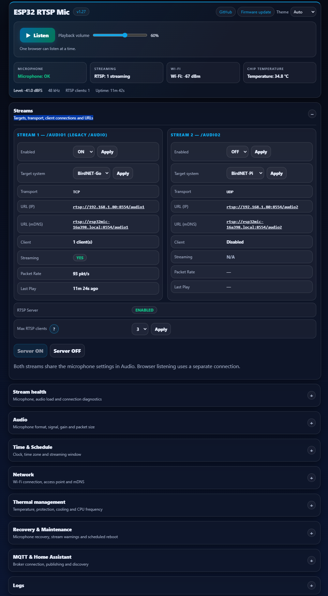

<p align="center">
  
</p>

# ESP32 RTSP Mic for BirdNET

Turn a **Seeed Studio XIAO ESP32** and a digital microphone into a Wi-Fi microphone
for **BirdNET-Go**, **BirdNET-Pi**, VLC or ffmpeg. Listen in your browser, adjust settings
and check device health without installing an app.

**Latest firmware: v1.33** · [Latest published release](https://github.com/Sukecz/esp32-birdnet-mic/releases/latest)
· [Web flasher](https://esp32mic.msmeteo.cz) · [Changelog](esp32-birdnet-mic/CHANGELOG.md)

## What's new in 1.33

- **OTA and thermal recovery fix:** stop audio capture and I2S/PDM clocks during updates and thermal shutdowns; restore capture after a failed update.
- Check temperature-driver errors and select an appropriate sensor range.
- Recovery requires five continuous minutes at least **10 °C below the shutdown limit**. Existing shutdowns migrate without clearing their history or safety blocks.

## What's new in 1.32

- **Experimental S3 boards with built-in microphones:** XIAO ESP32-S3 Sense and M5Stack AtomS3U — **needs more testing**.
- In S3 firmware, open **Audio → S3 board**, select the board and click **Apply board**. The built-in microphone uses 48 kHz PDM.
- XIAO ESP32-S3 / Plus with an external microphone remains the default. Board selection is saved across restarts and OTA updates.

## What's new in 1.31

- Review recommended microphone settings for your board before applying, or keep your saved values.
- Unsaved indicators clear when an edit returns to its saved value.
- Optional 240 MHz CPU setting on S3/C5.
- Fix C5 audio startup/reconfiguration when internal RAM is limited, for both I2S and PDM.
- Free 12 KiB of C5 RAM by sizing the browser-listening queue to 4 KiB.
- Document PDM gain settings when upgrading from the contributor's v15 firmware.

## What's new in 1.30

- **Redesigned Web UI:** collapsible sections, clear device status and save/discard feedback.
- **Browser listening:** Listen/Stop and playback volume, alongside your BirdNET streams.
- **Experimental PDM support:** IM73D122 on XIAO C3/S3/C5/C6, with mono 48 kHz output.
- **Better diagnostics:** microphone flatline detection, audio-processing load and capture errors.
- **Optional recovery after cooling:** streaming can resume automatically after a thermal shutdown.
- **Audio and OTA improvements:** integer audio processing, adaptive memory reserve and smaller C3/C6 builds.

Normal OTA updates keep the existing partition layout and saved settings. No USB migration is required.

## Support at a glance

🟢 **Supported** — implemented; hardware evidence is stated below.
🟡 **Experimental** — implemented, but integrated hardware validation is incomplete.
🔴 **Not supported** — unavailable in this firmware.

| Feature | Status | Details |
|---|---|---|
| I2S microphones | 🟢 Supported | ICS-43434, SPH0645LM4H and INMP441; see microphone table |
| PDM microphones | 🟡 Experimental | 48 kHz mono; physical validation of this integrated firmware is pending |
| PCM1808 external ADC | 🟡 Experimental | Audio remained noisy in testing; not recommended for a new build |
| BirdNET-Go / BirdNET-Pi | 🟢 Supported | RTSP over TCP / UDP respectively |
| Browser listening | 🟢 Supported | One browser listener, separate from RTSP client slots |
| Web settings, logs and JSON API | 🟢 Supported | Includes microphone, Wi-Fi, temperature and stream health |
| MQTT / Home Assistant discovery | 🟢 Supported | Optional broker connection |
| Streaming schedule and deep sleep | 🟢 Supported | Local-time windows, including overnight schedules |
| Thermal protection | 🟢 Supported | Optional automatic recovery is OFF by default |
| USB installation and OTA updates | 🟢 Supported | Separate firmware for each supported board |
| Stereo, USB audio or Bluetooth audio | 🔴 Not supported | Output is mono PCM over the network |
| SD-card recording | 🔴 Not supported | Recording/analysis belongs on the receiving system |

All four XIAO targets have build support. Maintainer runtime testing primarily uses **C6 with
ICS-43434**; a successful build does not establish long-term hardware stability on every board.

## Web UI



*Base interface shown; v1.31 also adds a microphone-settings recommendation dialog.*

<a id="parts-list"></a>

## Recommended hardware

Choose **one ESP32 board and one microphone**, then add the accessories below.

### ESP32 boards

| Board | Recommendation | Link |
|---|---|---|
| **XIAO ESP32-S3** | ⭐ **Recommended** for new builds; hardware PDM conversion | [Seeed Studio](https://www.seeedstudio.com/XIAO-ESP32S3-p-5627.html) |
| XIAO ESP32-C6 | Maintainer's reference board; software PDM conversion | [Seeed Studio](https://www.seeedstudio.com/Seeed-Studio-XIAO-ESP32C6-p-5884.html) |
| XIAO ESP32-C3 | Supported; use 512-sample packets and 160 MHz for PDM | [Seeed Studio](https://www.seeedstudio.com/Seeed-XIAO-ESP32C3-p-5431.html) |
| XIAO ESP32-C5 | Supported; use 512-sample packets and 160 MHz for PDM | [Seeed Studio](https://www.seeedstudio.com/Seeed-Studio-XIAO-ESP32C5-p-6609.html) |

### Experimental S3 boards with built-in microphones

🟡 **Experimental — needs more testing.** Available since v1.32.

Use the **S3 firmware** for **XIAO ESP32-S3 Sense** and **M5Stack AtomS3U**.
In the device Web UI, open **Audio → S3 board**, select your board and click
**Apply board**. This selects its built-in PDM microphone at 48 kHz and saves the
choice across restarts and OTA updates. Check **Signal Level / Listen** and adjust
**Gain** as needed.

The default is **XIAO ESP32-S3 / Plus (default)** with an external microphone; select the
microphone format below it as usual. The board selector appears only in S3 firmware.
When using an external microphone on a Sense board, select this default option too.

| Board option | Microphone | Status |
|---|---|---|
| XIAO ESP32-S3 Sense | Built-in PDM; no microphone wiring needed | 🟡 Experimental — needs more testing |
| M5Stack AtomS3U | Built-in PDM; no microphone wiring needed | 🟡 Experimental — needs more testing |

### Microphones

| Choice | Microphone | Interface | Notes / link |
|---|---|---|---|
| ⭐ **Recommended** | **Adafruit SPH0645LM4H** | I2S | Contributor-tested; select **MSB / left-justified**. [Adafruit #3421](https://www.adafruit.com/product/3421) |
| 🏆 **Best quality** | **Infineon IM73D122 breakout** | PDM · 🟡 Experimental | Low-noise option with **73 dB(A) SNR**; integrated hardware validation is pending. [Example module](https://www.aliexpress.com/item/1005010674767599.html) |
| Alternative PDM | **Adafruit PDM MEMS Microphone Breakout** / **MP34DT01-M** | PDM · 🟡 Experimental | Contributor-reported compatible; **61 dB SNR**. [Adafruit #3492](https://www.adafruit.com/product/3492) |
| Alternative PDM | **MP34DT01 PDM MEMS modules** | PDM · 🟡 Experimental | Generic breakouts are contributor-reported compatible; check the exact chip, supply and pinout. Search by **MP34DT01**. |
| Existing builds | **ICS-43434** | I2S | Maintainer-tested reference; select **Philips I2S**. [TDK product status](https://product.tdk.com/en/search/sw_piezo/mic/mems-mic/info?part_no=ICS-43434) |
| Existing builds | **INMP441** | I2S | [User-reported compatible](https://github.com/Sukecz/esp32-birdnet-mic/discussions/25); select **Philips I2S**. [TDK product status](https://product.tdk.com/en/search/sw_piezo/mic/mems-mic/info?part_no=INMP441) |

**Best quality** identifies the IM73D122's lower specified microphone noise: its
[73 dB(A) SNR](https://www.infineon.com/product-table/mems-microphones) compares with
[65 dB(A) for SPH0645LM4H](https://cdn-shop.adafruit.com/product-files/3421/i2S%20Datasheet.PDF).
These are component specifications; final audio also depends on the breakout, wiring,
placement and PDM conversion. PDM support remains experimental.

Adafruit #3492 uses the [MP34DT01-M](https://learn.adafruit.com/adafruit-pdm-microphone-breakout/downloads);
**it is a different microphone from IM73D122**. Both use the existing **PDM microphone (IM73D122)**
selection in the Web UI. Similar PDM modules may work if they accept **3.3 V**, a **3.072 MHz clock**
and left-slot output, but other models are not automatically validated. Check their datasheet and
breakout pin labels. See [microphones and wiring](#microphones-and-wiring).

### Accessories

| Accessory | Needed | Notes / link |
|---|---|---|
| **USB-C data cable** | Initial setup | Required for USB flashing; a charge-only cable will not work |
| **5 V USB power supply** | Continuous operation | At least 1 A recommended; USB-C is the simplest power connection |
| **2.4 GHz antenna, IPEX/U.FL** | Recommended | Use the antenna appropriate for your board. [Example](https://www.aliexpress.com/item/1005005439361093.html) |
| Short microphone wires / shielded cable | Wiring | I2S needs 5 conductors; PDM needs 4 when SEL is tied to GND at the mic. Keep wires short. [Example cable](https://www.aliexpress.com/item/1005010375728700.html) |
| Regulated **5 V** supply for 5V/VBUS input | Optional alternative | [Example](https://www.aliexpress.com/item/1005002624537795.html) — select **5 V**; the listing may default to **12 V**, which must never be connected to the XIAO |

Links are examples. Verify the exact part and breakout supply rating before buying.
Power the XIAO through USB-C or its 5V/VBUS input; do not connect both power sources at once.
A higher-wattage USB supply is fine because the board draws only the current it needs.
Power the microphone from **3V3**, following its breakout specification.

## Quick start

1. Choose a board and microphone from the [recommended hardware](#recommended-hardware), then wire it with power disconnected.
2. Connect the XIAO by **USB-C data cable**. Open the [web flasher](https://esp32mic.msmeteo.cz)
   in desktop Chrome or Edge, click **Flash**, and select the device. Chip detection selects the image;
   the supplied firmware is intended for XIAO boards.
3. Join **ESP32-RTSP-Mic-AP**. Open `http://192.168.4.1` if the setup page does not appear,
   then save your Wi-Fi details.
4. Open `http://<device-ip>/` using the address shown in your router's device list.
5. In **Audio → Microphone format**, select your microphone and apply. Review the recommended
   settings and save, or keep your saved values. Follow the PDM steps below if applicable.
6. Press **Listen** to check the sound. In **Streams**, enable a stream, choose BirdNET-Go or
   BirdNET-Pi, and copy its URL into that system. Stream 1 is enabled by default; Stream 2 is optional.

```text
rtsp://<device-ip>:8554/audio1    Stream 1 (default target: BirdNET-Go)
rtsp://<device-ip>:8554/audio2    Stream 2 (default target: BirdNET-Pi)
```

Both streams share the microphone settings. Up to 1–3 RTSP clients are configurable (default: 2).
The device's `.local` hostname can replace its IP where your network supports mDNS.

## Microphones and wiring

### I2S microphones

| Microphone | Select in Audio → Microphone format | Hardware evidence |
|---|---|---|
| **Adafruit SPH0645LM4H** | MSB / left-justified | Contributor-tested; recommended I2S option for new builds |
| **ICS-43434** | Philips I2S (default) | Maintainer-tested reference |
| **INMP441** | Philips I2S | [User-reported compatible](https://github.com/Sukecz/esp32-birdnet-mic/discussions/25) |

<picture>
  <source media="(prefers-color-scheme: dark)" srcset="assets/connection-dark.png">
  <source media="(prefers-color-scheme: light)" srcset="assets/connection.png">
  
</picture>

Use the **printed XIAO pin labels** below on C3/S3/C5/C6; GPIO numbers differ between boards.

| I2S microphone pin | XIAO pin |
|---|---|
| VDD / VCC | 3V3 |
| GND | GND |
| BCLK / SCK | D3 |
| LRCLK / WS | D1 |
| SD / DOUT | D2 |
| L/R / SEL | GND (left channel) |

Leave D7 unused for these microphones. See the [GPIO table and PCM1808 notes](esp32-birdnet-mic/README.md#i2s-wiring)
for advanced setups. Use **3.3 V**, not 5 V, for the microphone.

### PDM microphone — 🟡 Experimental

IM73D122, Adafruit PDM (#3492 / MP34DT01-M) and compatible MP34DT01 breakouts use
**different wiring from I2S**. Use the PDM selection for all of them; the Web UI label
currently names IM73D122. Check each breakout's pin labels:

| PDM microphone pin | XIAO pin |
|---|---|
| VDD / VCC / 3V | 3V3 (check the breakout's supply rating) |
| GND | GND |
| CLK | D3 |
| DATA / DAT | D2 |
| SEL / L-R | GND (left slot) |

Leave **D1 and D7 disconnected**. Check the module's pin labels before connecting power.
Select **PDM microphone (IM73D122)** in Audio; this sets **48 kHz** automatically.
Gain and high-pass filtering remain available; I2S Shift does not apply. Use **Recommended settings** to review the board/microphone profile before saving, or choose **Keep saved values and save** to retain your tuning.

When upgrading from the contributor's v15 PDM firmware, start with
**new Gain = old Gain × 2^(16 − old I2S Shift)**, then check the level/clipping.
For example, Shift 12 / Gain 1.5 becomes Gain 24. Saved Gain is not changed automatically.

**On C3/C5, set Audio → Advanced audio settings → RTP packet size to 512 samples,
and use 160 MHz CPU in Thermal management.** The default packet size is already 512, but
choosing **Keep saved values and save** preserves a previously saved larger size. The firmware reduces its internal audio
reserve when RAM is limited; this does not automatically change the packet-size setting.

S3 uses hardware PDM conversion; C3/C5/C6 use software conversion. Contributor hardware
tests used the contributing firmware. Physical microphone and long-running tests of this integrated
release are still pending, so PDM remains experimental on all four boards.
[Detailed PDM notes](esp32-birdnet-mic/README.md#pdm-microphones-experimental).

## Everyday use and troubleshooting

- **No sound:** check wiring and microphone format, enable the RTSP server, then press Listen.
  A flatline warning means the captured samples have stopped changing; it is not a microphone-quality measurement.
- **Dropouts:** check Wi-Fi signal, attach the board's antenna, and start with 512 samples per packet.
  Use the target setting matching BirdNET-Go (TCP) or BirdNET-Pi (UDP).
- **Noise:** keep microphone wires short and away from the antenna. Try lower Wi-Fi transmit power
  when the access point is nearby. High-pass filtering reduces low-frequency rumble (default: 500 Hz).
- **Temperature warning:** improve cooling or placement. Automatic recovery is optional and OFF
  by default; repeated or emergency shutdowns need acknowledgement after cooling.
- **Browser playback stops:** only one browser can listen at a time. Leaving/hiding the page,
  changing audio settings or updating firmware stops playback; press Listen again when ready.
- **Updates:** open **Firmware update** in the device header. Automatic update uses the published
  image; manual upload needs `firmware-app-<board>.bin`. Never use a merged `firmware-<board>.bin` for OTA.

Keep the device on a trusted LAN: HTTP/RTSP have no built-in user authentication or TLS.
For setup details, schedules, MQTT and API examples, see the [firmware guide](esp32-birdnet-mic/README.md).

## Build From Source

Use Bash (Linux, macOS, or Windows WSL), Python 3 and Arduino CLI **1.5.0**.
Run these commands from the repository root. First-time dependency setup:

```bash
arduino-cli config add board_manager.additional_urls https://espressif.github.io/arduino-esp32/package_esp32_index.json
python3 tools/check_build_dependencies.py --install
```

Build a XIAO ESP32-C6 image:

```bash
tools/compile_firmware.sh --fqbn esp32:esp32:XIAO_ESP32C6 \
  --output-dir esp32-birdnet-mic/build/c6
```

For another supported board, replace `XIAO_ESP32C6` with `XIAO_ESP32C3`, `XIAO_ESP32S3`,
or `XIAO_ESP32C5` and choose a matching output folder. The helper automatically enables
LTO for C3/C6; S3/C5 keep normal compilation.

For OTA, select `esp32-birdnet-mic/build/c6/esp32-birdnet-mic.ino.bin` under
**Firmware update -> Upload compiled file** in the device Web UI. Use the image built for
your board; OTA needs the app-only `.ino.bin`, not the `.merged.bin` USB image.
Existing devices use the same OTA procedure and partition layout.

Ordinary Arduino IDE or direct `arduino-cli compile` builds do not automatically enable LTO.
See the [full build instructions](esp32-birdnet-mic/README.md#build-and-flash-manually)
for more details.

### Arduino IDE Build Size

Keep `esp32-birdnet-mic/build_opt.h` next to the sketch. The ESP32 Arduino core loads it
automatically in Arduino IDE and `arduino-cli`; it disables WiFiManager serial debug output
and unused C++ exception/unwind metadata. The CLI helper above also applies the C3/C6 LTO
settings used for the packaged firmware.

## More documentation

- [Firmware guide and API](esp32-birdnet-mic/README.md)
- [Manual OTA files](manual-ota-firmware/README.md)
- [Web flasher and firmware file guide](web-flasher/README.md)
- [Release history](esp32-birdnet-mic/CHANGELOG.md)

## Credits and license

Created by **@Sukecz**, with thanks to **Dan Logue** for his PDM contribution and hardware testing,
and to everyone reporting compatibility and testing new builds. Released under the [MIT License](LICENSE).
